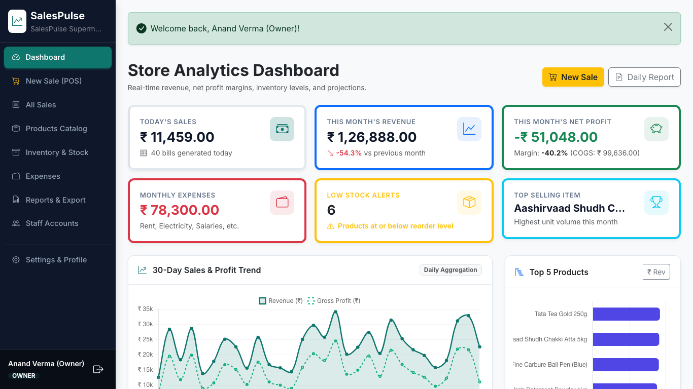
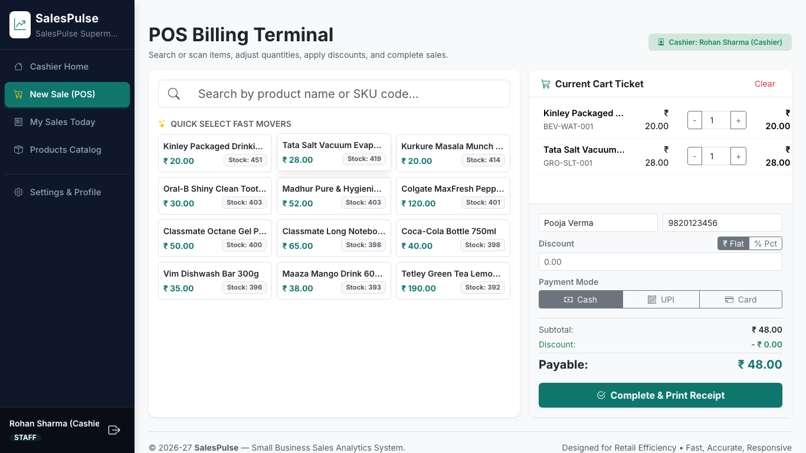
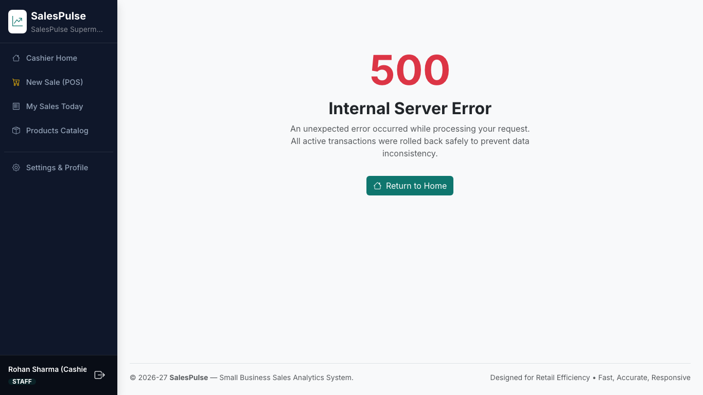
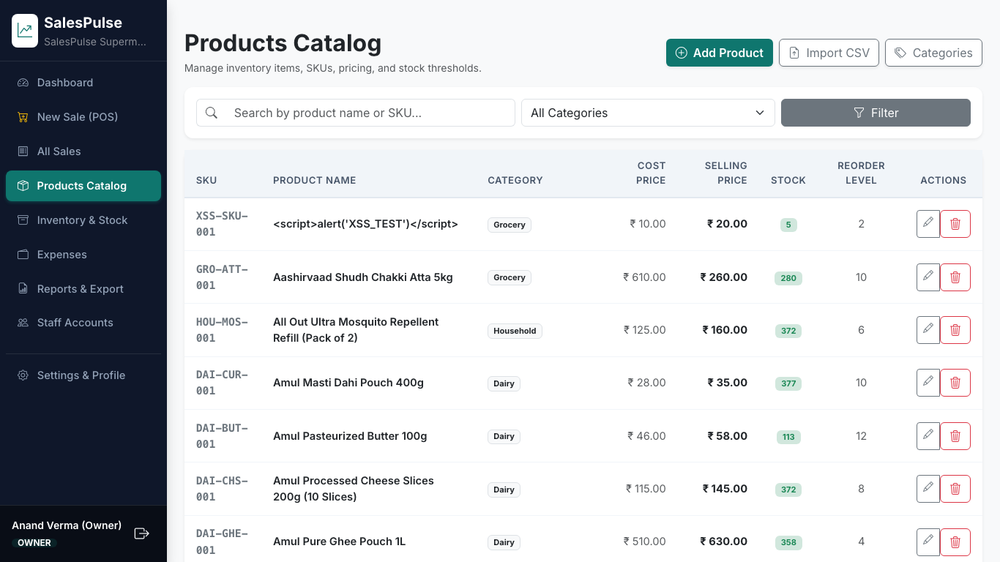
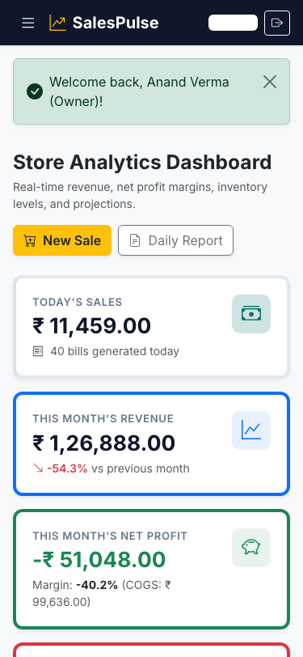

# SalesPulse — Small Business Sales Analytics System

[](https://python.org)
[](https://flask.palletsprojects.com/)
[](https://www.mysql.com/)
[]()

> **SalesPulse** is an end-to-end web-based sales, inventory, and profit analytics management system designed specifically for small retail businesses (kirana stores, stationery shops, bakeries, mobile accessory shops). It transforms raw checkout transactions into actionable financial insights, real-time stock alerts, and predictive sales forecasts.

---

## 🌟 Key Highlights & Engineering Features

- **Accurate Financial Identity**: Computes real-time profit using:
  $$\text{Net Profit} = \text{Gross Revenue} - \text{Cost of Goods Sold (COGS)} - \text{Operating Expenses}$$
- **Point-in-Time Cost Snapshotting**: Snapshots `unit_cost` and `unit_price` inside `sale_items` at checkout. Future price modifications never retroactively alter historical accounting.
- **Transactional Stock Decrement (ACID)**: Employs `SELECT ... FOR UPDATE` row-level locking to prevent concurrent overselling during checkout.
- **Interactive POS Billing Terminal**: Sub-second product search with autocomplete, quantity adjustments, flat/percentage discounts, and instant printable tax receipts (`SP-YYYYMMDD-XXXX`).
- **Live Visual Analytics**: Interactive Chart.js dashboard featuring:
  1. 30-Day Sales & Gross Profit Trend (Line)
  2. Top 5 Products by Quantity or Revenue (Horizontal Bar with toggle)
  3. Monthly Overhead Expense Breakdown (Doughnut)
  4. Category Sales Distribution (Pie)
  5. 6-Month Grouped Revenue vs. Expenses Comparison (Bar)
  6. 7-Day Autoregressive Moving Average Sales Forecast with Weekday Seasonality
- **Inventory Risk Intelligence**: Automatic detection of low-stock items (`stock_qty <= reorder_level`) and slow-moving dead stock (items with 0 sales in 30 days).
- **Comprehensive Reporting & Export**: Daily, monthly, custom date range, and catalog performance reports exportable to RFC-4180 CSV and formatted vector PDF (via ReportLab).
- **Role-Based Access Control (RBAC)**: Distinct permissions for **Store Owner** (full administrative, margin, and expense visibility) and **Staff Cashier** (billing and shift sales only; cost prices strictly concealed).

---

## 📸 Application Screenshots

### 1. Store Analytics Dashboard (Owner View)


### 2. POS Billing Terminal (Fast Cashier Checkout)


### 3. Retail Tax Invoice Receipt (Printable)


### 4. Products Catalog & Stock Management


### 5. Responsive Mobile Experience (375px Viewport)


---

## 🛠️ Technology Stack

| Component | Technology | Rationale |
|---|---|---|
| **Language** | Python 3.11+ | High productivity, rich analytical ecosystem |
| **Web Framework** | Flask 3.x (Blueprints) | Modular MVC architecture with low runtime overhead |
| **Database** | MySQL 8.x | ACID compliance, transactional row-locking, relational integrity |
| **Driver & Pooling** | `mysql-connector-python` | Native Python connection pooling and parameterized query execution |
| **Frontend Framework** | Bootstrap 5.3 & Vanilla JS | Clean responsive layout without heavy client framework bundles |
| **Charts & Visuals** | Chart.js 4.4 | Smooth canvas rendering for time-series and categorical charts |
| **Auth & Security** | Werkzeug & Flask-WTF | PBKDF2/scrypt password hashing and strict CSRF protection |
| **Document Export** | ReportLab 4.x / Python `csv` | High-quality programmatic PDF and spreadsheet generation |
| **Test Automation** | Pytest, Pytest-Flask, Playwright | Comprehensive unit, integration, and headless browser flow testing |

---

## 🚀 Setup & Local Installation

### Prerequisites
- Python 3.11 or higher
- MySQL Server 8.x (running locally on port 3306)
- Git

### 1. Clone & Enter Directory
```bash
git clone <repository_url> salespulse
cd salespulse
```

### 2. Configure Environment Variables
Copy `.env.example` to `.env`:
```bash
cp .env.example .env
```
Ensure your MySQL credentials match `.env`:
```env
DB_HOST=localhost
DB_PORT=3306
DB_USER=root
DB_PASSWORD=
DB_NAME=salespulse
SECRET_KEY=salespulse_development_secret_key_8847291a7c3b4e
```

### 3. Set Up Virtual Environment & Dependencies
```bash
python3 -m venv venv
source venv/bin/activate
pip install -r requirements.txt
playwright install chromium
```

### 4. Initialize Database Schema
Execute the schema script in MySQL:
```bash
mysql -u root < schema.sql
```

### 5. Seed Database with Realistic 90-Day Retail Data
```bash
python seed.py
```
*Seeds ~60 products across 8 categories, 90 days of continuous sales (~2,600 bills), operating expenses, and low-stock alerts.*

### 6. Run the Application
```bash
python app.py
```
Open your browser and navigate to:
```
http://127.0.0.1:5000/login
```

---

## 🔐 Default Demo Credentials

| Role | Email | Password | Permissions |
|---|---|---|---|
| **Store Owner (Admin)** | `owner@salespulse.com` | `Owner@123` | Full access: Dashboard, profit numbers, expenses, reports, staff management |
| **Staff Cashier** | `staff@salespulse.com` | `Staff@123` | Billing terminal, view own shift sales; cost prices and profit concealed |

---

## 🧪 Running the Test Suite

SalesPulse includes 44 exhaustive automated test cases covering unit logic, transactional safety, role security, and report generation:

```bash
# Run pytest with coverage report
PYTHONPATH=. pytest -v --cov=services --cov=blueprints --cov=utils

# Run Playwright automated browser flow and capture screenshots
PYTHONPATH=. python tests/capture_screenshots.py

# Render architectural Mermaid diagrams to PNG
PYTHONPATH=. python tests/render_diagrams.py
```

---

## 📁 Repository Structure

```
salespulse/
├── app.py                      # Flask application factory & middleware
├── config.py                   # Environment configuration & security constants
├── db.py                       # MySQL connection pool & query helpers
├── seed.py                     # Realistic 90-day retail data generator
├── schema.sql                  # 3NF relational database schema
├── requirements.txt            # Python dependencies
├── .env.example                # Environment configuration template
├── README.md                   # Project documentation & user guide
├── blueprints/                 # Modular Flask routing controllers
│   ├── auth.py                 # Login rate-limiting & session handling
│   ├── products.py             # Products catalog & CSV bulk import
│   ├── sales.py                # POS checkout & printable receipt generator
│   ├── expenses.py             # Overhead expenditure management
│   ├── dashboard.py            # Owner & Cashier dashboard endpoints
│   ├── stock.py                # Stock adjustments & inventory risk alerts
│   ├── reports.py              # Financial reports & PDF/CSV streaming
│   ├── users.py                # Staff user accounts administration
│   └── settings.py             # Store profile & password management
├── services/                   # Encapsulated business & analytical logic
│   ├── sales_service.py        # ACID transactional checkout & row-locking
│   ├── stock_service.py        # Stock movement ledger & slow-moving logic
│   ├── analytics_service.py    # Revenue, COGS, Net Profit & margin metrics
│   ├── forecast.py             # 7-Day autoregressive moving average forecaster
│   ├── export_service.py       # ReportLab PDF & CSV builders
│   └── csv_import.py           # Bulk product CSV parser & validator
├── utils/                      # Decorators, formatters & validators
│   ├── decorators.py           # @login_required, @owner_required
│   ├── formatters.py           # Indian Rupee (₹) & date formatters
│   └── validators.py           # Data boundary & email sanitizers
├── templates/                  # Jinja2 HTML templates
│   ├── base.html               # Master layout with responsive sidebar
│   ├── login.html              # Clean authentication screen
│   ├── dashboard.html          # Owner analytical dashboard
│   ├── staff_home.html         # Cashier home dashboard
│   ├── products/               # Catalog, form, categories & CSV import
│   ├── sales/                  # POS billing terminal, history & receipts
│   ├── expenses/               # Overhead list & recording forms
│   ├── stock/                  # Inventory levels, alerts & movement ledger
│   ├── reports/                # Daily, monthly, custom & product reports
│   ├── users/                  # User management views
│   ├── settings.html           # Store profile configuration
│   └── errors/                 # 403, 404, 500 error templates
├── static/                     # Static assets
│   ├── css/style.css           # Custom styles & print receipt rules
│   └── js/                     # billing.js, charts.js, main.js
├── tests/                      # Automated test suite
│   ├── conftest.py             # Pytest fixtures & test database setup
│   ├── test_unit_calc.py       # Unit tests for profit & forecaster
│   ├── test_sales_flow.py      # Integration tests for transactional billing
│   ├── test_security.py        # Security & RBAC verification
│   ├── test_reports.py         # Reporting & export tests
│   ├── test_additional_cases.py# CRUD edge-case test coverage
│   ├── test_flow_e2e.py        # Playwright browser integration
│   ├── capture_screenshots.py  # Automated screenshot capture script
│   └── render_diagrams.py      # Mermaid diagram rendering script
└── docs/                       # Engineering artifacts & viva guides
    ├── progress_log.md         # Daily development milestone log
    ├── test_results.txt        # Full TC01-TC44 validation audit
    ├── viva_notes.md           # Examiner questions & 5-minute demo script
    ├── diagrams/               # 12 rendered architectural PNG diagrams
    └── screenshots/            # 23 real application desktop & mobile screenshots
```

---

## 📜 Academic Integrity & Viva Notes

Detailed answers to common examiner questions and a step-by-step 5-minute examination demo walkthrough are documented in [`docs/viva_notes.md`](docs/viva_notes.md).

Developed for academic year **2026–27**.
